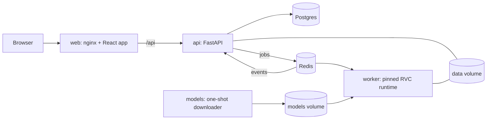

# Voicely

Take any song, recording or piece of text and hear it performed in a voice you built.

Voicely is a self-hosted platform around RVC (Retrieval-based Voice Conversion). It keeps the
words, timing and melody of a performance and re-renders them in a target voice. The design
follows Option A of [RVC_ARCHITECTURE.md](RVC_ARCHITECTURE.md): the frozen 2023 RVC runtime is
wrapped as an isolated worker behind a job queue, with a normal API and web app in front.

## What it does

| Flow | Input | What happens |
|---|---|---|
| **Song cover** | A full song | Vocals are separated from the music, converted to the chosen voice, and mixed back with reverb, volume and key controls. |
| **Voice swap** | Clean speech or a cappella (upload or record) | Converted directly. |
| **Text to voice** | Typed text | A narrator (Piper TTS, 6 voices in English, Hindi and Spanish) reads it, then it is converted. |
| **Build a voice** | 2 to 90 minutes of recordings | Each recording is checked for clipping, noise and silence. Train on the server, or export the set to train on Colab. |
| **Train on Colab** | The recordings zip plus the bundled notebook | For servers without an NVIDIA GPU. The notebook runs the server's own training pipeline on a free Colab GPU and returns one zip. |
| **Import a voice** | The Colab zip, or a `.pth` and optional `.index` | Loaded in a restricted mode, checked against its index, then made available. |

Voices are private to their owner unless the owner shares them with everyone on the server.
Every voice carries a consent record, and every output file is tagged as AI-generated.

## Quick start

Needs Docker with Compose, about 7 GB of disk (5 GB of images, 1 GB of models, plus your
audio), and 8 GB of RAM available to Docker.

```
cp .env.example .env        # then set SECRET_KEY to a long random value
docker compose up -d --build
```

Open **http://127.0.0.1:8080** and create an account.

The first start downloads about 1.1 GB of base models; the status pill in the top bar turns
green when the engine is ready. Follow along with `docker compose logs -f models worker`.

To build your first voice, open **Voices → New voice**. The in-app **Guide** covers recording,
training and importing in detail.

### With an NVIDIA GPU

```
docker compose -f docker-compose.yml -f docker-compose.gpu.yml up -d --build
```

This builds the CUDA 11.7 variant of the worker (about 5 GB larger) and passes the GPU through.
It needs the NVIDIA Container Toolkit. **This path is untested**: see "What is verified".

## Architecture



| Service | What it is | Network |
|---|---|---|
| `web` | nginx serving the React app and proxying `/api` | published on `127.0.0.1:8080` |
| `api` | FastAPI, Python 3.12. Accounts, voices, jobs, uploads, signed file links | internal only |
| `worker` | Ubuntu 22.04, Python 3.10, the pinned Mangio RVC fork, MDX-Net separation, Piper | internal only, **no internet** |
| `models` | Same image as the worker; downloads base models once, then exits | internet |
| `postgres`, `redis` | Database and queue | internal only |

How a job moves: the API saves the upload, writes a `jobs` row and pushes a message to Redis.
The worker pops it, works on files in the shared data volume, and pushes progress events back.
A consumer inside the API applies those events to the database. The worker never connects to
Postgres and holds no secrets.

```
api/      FastAPI app            app/routers, app/events.py (event consumer), app/storage.py
worker/   RVC runtime            voicely_worker/engine.py (conversion), separate.py, train.py, tts.py
          engine/                build-time requirements fix-ups and patches to the fork
web/      React + Vite + Tailwind   src/pages, src/components
tools/    build_colab_notebook.py   regenerates web/public/voicely-train-colab.ipynb
```

The Colab notebook embeds the worker's training code. After changing `worker/engine/*` or
`worker/voicely_worker/train.py`, run `python tools/build_colab_notebook.py` and rebuild `web`.

### Changes made to the RVC engine

The fork is pinned by commit and patched at build time (`worker/engine/patch_engine.py`); the
build fails if the upstream text no longer matches.

- **Training on CPU did nothing.** With no GPU the trainer spawned zero processes and exited
  successfully. It now runs one CPU process.
- **Pitch extraction for training hardcoded `cuda:0`.** It now falls back to CPU.
- The engine's `Config` class and audio loader are not used; `engine.py` calls `VC.pipeline`
  directly. The originals rewrite config files on import and depend on a CSV in the working
  directory.

Two behaviours are added around the engine rather than in it:

- **Long audio is converted in ~30 s chunks**, cut at quiet moments. Each chunk is padded back to
  its exact length, because the engine returns every call about 16 ms short and that drift would
  pull a cover's vocal ahead of the music.
- **Voice models load with `weights_only=True`**, so a `.pth` cannot execute code on load.

## What is verified

Everything below was run on this stack on a CPU-only machine (8 cores, 12 GB given to Docker),
through the public API.

| Check | Result |
|---|---|
| Clean build and first boot of all services | Pass |
| Train a voice (2.7 min of audio, 62 clips, 2 epochs) | Pass: 9 min, produced a 55 MB model and an 8,163-vector index |
| Voice swap with −12 semitones | Pass: median pitch 209 Hz in, 106 Hz out, same length |
| Text to voice | Pass |
| Song cover on a synthetic song (speech over a chord) | Pass: correlation of the voice with the instrumental stem 0.001 |
| 140 s conversion in 5 chunks | Pass: output length matches input to 0.1 ms |
| Import a model and index, then convert with it | Pass |
| Malicious pickle uploaded as a `.pth` | Rejected; payload did not run |
| Truncated model, non-FAISS index, `G_*.pth` checkpoint | Each rejected with a specific message |
| Cancel a queued job and a running job | Pass |
| Kill the worker mid-job | Job marked failed after ~2 min; worker recovers on restart |
| Second user: private voices, jobs and datasets | Not visible; shared voice usable but not editable |
| Tampered and forged file links | 404 |
| UI at 1440 px and 390 px | Renders without console errors or horizontal overflow |

**Not verified:**

- **Anything on a GPU.** The CUDA image has not been built or run, including half precision and
  ONNX Runtime's CUDA provider. Expect to fix something the first time.
- **Audio quality by ear.** Checks were numeric (pitch, length, correlation). The test voice was
  trained for 2 epochs on synthetic speech, which proves the pipeline, not the sound.
- **Separation on real music.** The cover test used speech over a synthetic backing.
- **Browser microphone recording.** The recorder UI was not exercised with a real microphone.
- **The Colab notebook on real Colab.** All its cells were run start to finish in a clean
  Python 3.12 container on CPU (install, 1-epoch training, zip output), and that zip format
  imports correctly. It has not been run on Colab itself or on a GPU.

### Measured speed (CPU, 8 cores)

| Task | Time |
|---|---|
| Voice swap | about 1.5× the length of the audio |
| Vocal separation | about 1× the length of the song |
| Full song cover | about 3× the length of the song |
| Training | about 4 min per epoch for 2.7 min of audio. 200 epochs would take roughly 13 hours. |

CPU is fine for conversion. For training a real voice, use a GPU or the Colab route.

## Configuration

Set in `.env` (see [.env.example](.env.example)).

| Variable | Default | Meaning |
|---|---|---|
| `SECRET_KEY` | `change-me` | Signs logins and file links. **Must be changed.** |
| `WEB_BIND`, `WEB_PORT` | `127.0.0.1`, `8080` | Where the site is published |
| `ALLOW_REGISTRATION` | `true` | Set `false` once your accounts exist |
| `MAX_AUDIO_MINUTES` | `10` | Longest audio per job |
| `MAX_UPLOAD_MB` | `200` | Largest audio upload |
| `WORKER_QUEUES` | `fast,train` | Queues a worker serves |
| `VOICE_CACHE_SIZE` | `2` | Voice models kept in memory |
| `WORKER_MAX_RSS_MB` | `5000` | Worker restarts itself between jobs above this |
| `MDX_DENOISE` | `0` | `1` = cleaner separation, twice as slow |

More limits (dataset size, concurrent jobs per user, TTS length) are in `api/app/config.py`.

## Operating it

```
docker compose logs -f worker        # engine output, including full tracebacks
docker compose ps                    # service state
docker compose down                  # stop; data is kept
docker compose down -v               # stop and delete everything, including models
```

- **API reference:** http://127.0.0.1:8080/api/docs
- **Memory:** a 140 s conversion peaks near 3.7 GB in the worker. Memory still creeps up across
  jobs, so the worker exits between jobs once it passes `WORKER_MAX_RSS_MB` and Docker restarts
  it; reloading takes about 15 s. If a job is killed for memory, it is marked failed.
- **Training blocks conversions** on a single worker. To separate them, run a second worker
  service with `WORKER_QUEUES=train` and set the first to `fast`.
- **Backups:** the `pgdata` and `data` volumes hold everything users made. `models` can be
  re-downloaded.
- **Abuse reports** land in the `reports` table. There is no admin screen yet.
- **Schema changes:** tables are created on start but never altered. There are no migrations.

## Security and consent

- The worker loads user-supplied model files, so it runs unprivileged, with no internet, no
  database access and no secrets. Voice models are opened with a restricted unpickler.
- It does share the data volume with the API. A flaw in FAISS index parsing or ffmpeg could
  expose other users' audio to a hostile upload. For a public deployment, give each job its own
  sandbox.
- Creating a voice requires stating whose voice it is and confirming the right to clone it; the
  confirmation, time and IP are stored, and a spoken statement can be attached. Sharing a voice
  requires a second confirmation.
- This is an attestation, not proof. Nothing technically stops someone from lying, or from
  importing a model of someone else. Before opening this to the public, add identity checks,
  rate limits and moderation of reports.
- Outputs carry an "AI-generated" metadata comment. It is a label, not a watermark, and is
  trivially removed.
- The engine code and base models have their own licences, which have not been audited for
  commercial use. See section 10 of the architecture document.

## Developing

```
cd web && npm install && npm run dev      # UI on :5173, proxying /api to the stack on :8080
docker compose up -d --build api          # rebuild after API changes
docker compose up -d --build worker       # rebuild after worker changes (engine layers are cached)
```
