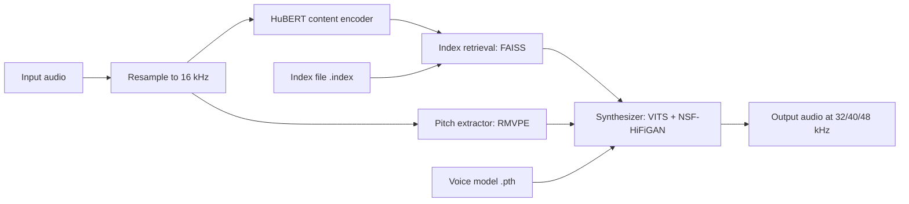
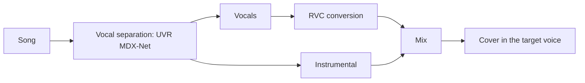
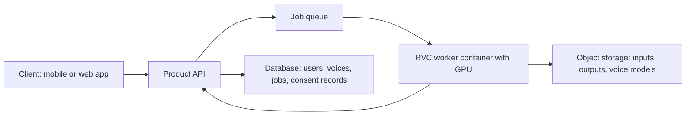

# RVC Voice Conversion: Architecture and Tech Stack

Last updated: 2026-10-13

This document explains how RVC (Retrieval-based Voice Conversion) works, the exact stack we got running, and how to build a product on top of it. It is written so that a developer or an AI agent with no prior context can pick it up and start work.

Statements are marked where they were not verified by us. Everything else was run and checked in this project.

---

## 1. Summary

- **What RVC does:** it takes a recording of someone speaking or singing and re-renders it in a different voice, keeping the words, timing and melody. It is speech-to-speech, not text-to-speech.
- **What a "voice" is:** a small trained model file (about 55 MB) plus an optional index file. Swapping voices means swapping these files.
- **What we have working:** the RVC v2 inference pipeline with a web GUI, running locally in Docker on CPU, and a repaired Google Colab notebook for GPU use.
- **What we have not done:** trained a custom voice, run on a GPU, or run on a phone.
- **Main engineering fact:** the open-source RVC code is from 2023 and only works with a pinned Python 3.10 dependency set. Treat it as a fixed runtime behind an API, not as a library to import into a modern codebase.

---

## 2. Core concept

### Voice conversion versus text-to-speech

| | Text-to-speech (TTS) | Voice conversion (RVC) |
|---|---|---|
| Input | Text | Audio of a person speaking or singing |
| Output | Speech in a model's voice | The same performance in a target voice |
| Controls timing and emotion | The model | The input performance |
| Works for singing | Rarely | Yes |

RVC cannot generate speech from text by itself. To get "text in my voice", chain the two: **any TTS engine produces speech, then RVC converts it into the target voice.** This pattern is common because RVC voices are cheap to train and the TTS engine can be swapped freely.

### What RVC is good and bad at

- **Good:** timbre change for speech and singing, short training data requirements, small model files, many community models.
- **Limited:** it copies the source's accent, pacing and pronunciation. A source that sounds nothing like the target in style will still sound like the source "wearing" the target's timbre.
- **Sensitive to input quality:** background music, reverb and noise in the input all degrade output. Songs must have vocals separated first (see section 6).

---

## 3. How RVC works

### Inference pipeline



Step by step:

1. **Load and resample.** The input is decoded with ffmpeg and resampled to 16 kHz mono.
2. **Content features (HuBERT).** A pretrained HuBERT model (`hubert_base.pt`) turns the audio into a sequence of feature vectors that describe *what is being said* with most of the speaker identity removed. RVC v2 models use 768-dimensional features; v1 models use 256.
3. **Retrieval (the "R" in RVC).** Each feature vector is looked up in a FAISS index built from the target speaker's training data. The nearest stored features are blended with the input features. The blend amount is the **index rate** (0 to 1). This pulls the content toward how the target speaker actually sounds and reduces leakage of the source voice. It is optional: with no index, this step is skipped.
4. **Pitch (F0) extraction.** A pitch tracker extracts the melody or intonation curve. We use **RMVPE** (`rmvpe.pt`), which is the best option in this codebase. The curve is shifted by a user-set number of semitones (for example +12 for male to female).
5. **Synthesis.** The voice model (a VITS-style network with an NSF-HiFiGAN decoder) takes the content features and the pitch curve and generates a waveform in the target voice, at the sample rate the model was trained for (32, 40 or 48 kHz).
6. **Post-processing.** Optional loudness-envelope mixing with the source and optional resampling.

### Parameters that matter

These are the arguments of the GUI's conversion function, with the values we tested:

| Parameter | Tested value | Meaning |
|---|---|---|
| `f0_up_key` | `0` | Pitch shift in semitones. Use about +12 or -12 across genders. |
| `f0_method` | `rmvpe` | Pitch extractor. Others: `pm`, `harvest`, `crepe`, `mangio-crepe`. |
| `file_index` | path to `added_*.index` | Index file. Empty string disables retrieval. |
| `index_rate` | `0.66` | How strongly to blend retrieved features. |
| `filter_radius` | `3` | Median filter on the pitch curve. |
| `resample_sr` | `0` | Output resample rate. `0` keeps the model's rate. |
| `rms_mix_rate` | `0.21` | How much of the source loudness envelope to keep. |
| `protect` | `0.33` | Protects consonants and breaths from artifacts. |
| `crepe_hop_length` | `120` | Only used by the crepe methods. |

---

## 4. Tech stack

### Runtime that works (verified)

| Component | Version | Role |
|---|---|---|
| OS | Ubuntu 22.04 | Container and Colab base |
| Python | 3.10 (isolated environment) | Required. The pins below do not install on newer Python. |
| PyTorch | 2.0.0 (CUDA 11.7 build) | Model inference |
| torchaudio | 2.0.1 | Audio ops |
| fairseq | 0.12.2 | Loads the HuBERT model |
| faiss-cpu | 1.7.2 | Index retrieval |
| numpy / numba / librosa | 1.23.5 / 0.56.4 / 0.9.1 | Audio and numeric code. These three must stay in step. |
| gradio | 3.34.0 | Web GUI |
| onnxruntime-gpu | 1.14.1 | Vocal separation models, and the advanced GUI |
| ffmpeg | system package | Audio decoding |
| uv | current | Creates the Python 3.10 environment and installs the pins |

The installed Python environment is about **5.1 GB**, mostly PyTorch and its bundled CUDA libraries.

### Source code

| Piece | Source | Pin |
|---|---|---|
| RVC engine | `Mangio621/Mangio-RVC-Fork` | commit `bf0ffdbc35da09b57306e429c6deda84496948a1` |
| Simplified GUI | `kalomaze/Mangio-Kalo-Tweaks`, file `EasierGUI.py` | commit `fb7c24461363d98e0671139e57812c1e0b441ed9` |
| Vocal separation | `kae0-0/Colab-for-MDX_B` | commit `9f9838cc569da1918716bda809a14b907d69bf91` |

The dependency list is the fork's own `requirements.txt` with these changes:

- **Removed:** `torchgen`, `pathlib`, `pyreadline3`, `PySimpleGUI`, `sounddevice` (Windows-only, not real packages, or needing extra system libraries).
- **Replaced:** `ffmpy==0.0.3` with `ffmpy==0.3.1` (the old one no longer builds correctly and breaks gradio).
- **Added:** `setuptools==69.5.1` (gradio and librosa need `pkg_resources`) and `gdown`.

### Shared base models (needed for every voice)

| File | Size | Purpose |
|---|---|---|
| `hubert_base.pt` | 190 MB | Content encoder |
| `rmvpe.pt` | 181 MB | Pitch extractor |

Both come from `https://huggingface.co/lj1995/VoiceConversionWebUI`.

---

## 5. Voice model files

A voice consists of two files:

| File | Typical size | Required | Purpose |
|---|---|---|---|
| `<name>.pth` | about 55 MB | Yes | The synthesizer weights for this voice |
| `added_*.index` | 30 to 200 MB | No | FAISS index of the speaker's training features |

### Folder layout inside the RVC directory

```
Retrieval-based-Voice-Conversion-WebUI/
├── hubert_base.pt
├── rmvpe.pt
├── weights/
│   └── <name>.pth
├── logs/
│   └── <name>/
│       └── added_<...>.index
└── audios/            # input files uploaded through the GUI
```

The GUI pairs a model with its index by folder name: `weights/Foo.pth` goes with `logs/Foo/*.index`.

### Things to know about model files

- **Files named `G_*.pth` or `D_*.pth` are training checkpoints, not voices.** They are large and cannot be loaded for inference. Some downloaded zips bundle them, which is why a zip can be over 1 GB.
- **`trained_*.index` is an intermediate file.** The usable one starts with `added_`.
- **`.pth` files are Python pickles.** Loading one can execute code. Only load models from sources you trust, and keep the runtime in a container.
- **v1 and v2 models both load.** The model file records its own version.

### Where community models come from

- Hugging Face (search "RVC"). A large 2023 archive is `QuickWick/Music-AI-Voices`; only its folders marked "(RVC)" are compatible.
- The AI Hub Discord, `#voice-models` channel.

Direct download links on Hugging Face use `/resolve/main/`, not `/tree/main/`. Cloning such a repository with git only fetches small Git LFS pointer files, not the models.

Community models are almost all celebrity or character voices. See section 10.

---

## 6. Workflows

### A. Speech conversion (verified)

1. Provide a clean voice recording.
2. Pick a voice model and pitch shift.
3. Convert.

### B. AI song cover (each stage verified separately)



- **Separation** uses UVR MDX-Net models run through onnxruntime. The full model set is about 1.4 GB.
- **Conversion** is workflow A applied to the vocal stem.
- **Mixing** the converted vocal back with the instrumental is not part of this codebase. Do it with ffmpeg or an audio editor.

### C. Text in a custom voice (not verified end to end)

1. Generate speech from text with any TTS engine.
2. Convert that speech with RVC.

The GUI has a built-in "Text To Speech" section that does this with gTTS or ElevenLabs. We did not test it.

### D. Training a custom voice (not done by us)

What the fork's training pipeline does, according to its code and documentation:

1. **Collect data:** 10 to 30 minutes of the target voice. Clean, dry, no music, no reverb, WAV.
2. **Preprocess:** slice into short clips and resample (`trainset_preprocess_pipeline_print.py`).
3. **Extract features:** pitch (`extract_f0_print.py`) and HuBERT features (`extract_feature_print.py`).
4. **Train:** fine-tune from pretrained base generator and discriminator weights (`train_nsf_sim_cache_sid_load_pretrain.py`). A few hundred epochs is typical for a small dataset.
5. **Build the index:** a FAISS index over the extracted features.
6. **Result:** `weights/<name>.pth` and `logs/<name>/added_*.index`.

Training needs an NVIDIA GPU in practice. A free Colab T4 is the usual choice. The pretrained base weights (`pretrained_v2/f0G40k.pth` and `f0D40k.pth`) are not downloaded by our setup, so the GUI's training tab is disabled.

---

## 7. Reference setup in this project

### Files

| File | What it is |
|---|---|
| `RVC_v2_Easy_GUI_fixed.ipynb` | Repaired Colab notebook: install, model download, GUI launch, vocal separation |
| `Easy_GUI_(for_RVC_v2,_with_crepe)_(with_improved_downloader).ipynb` | The original 2023 notebook, unmodified, for reference |
| `local-ui/entry.sh` | Container entry script: installs on first run, then serves the GUI |
| `local-ui/run_cells.py` | Runs selected notebook cells through IPython, as Colab would |

### Running the GUI locally

```
docker run -d --name rvc-local -p 127.0.0.1:7860:7860 \
  -v "<project path>:/nb:ro" -v "<project path>/local-ui:/local-ui:ro" \
  ubuntu:22.04 bash /local-ui/entry.sh
```

- First start takes roughly 15 to 20 minutes (about 5 GB of packages plus models). Later starts take under a minute.
- Open **`http://127.0.0.1:7860`**. Do not use `localhost`: the port is bound on IPv4 only, and the browser's WebSocket connection failed through `localhost`.
- Stop and start with `docker stop rvc-local` and `docker start rvc-local`.

### What was tested

All tests ran in an Ubuntu 22.04 container on CPU, with no GPU.

| Check | Result |
|---|---|
| Install cell from a clean state | Passes |
| Voice model download from Hugging Face | Passes |
| Conversion with RMVPE and an index | Passes: 3.1 s of audio in about 10 s, including first-time model loading |
| GUI over a gradio.live tunnel | Passes |
| GUI over a Cloudflare tunnel | Passes |
| Advanced GUI start-up | Passes |
| Vocal separation on CPU | Passes: a 3 s clip in about 8 s |
| Browser use by a person | Works: upload, model switching and conversion |

### Measured numbers

- **CPU conversion speed:** roughly 2 to 3 times slower than real time for short clips. Per-stage timing for a 3 s clip: features 0.5 s, pitch 1.5 s, synthesis 4.0 s.
- **Memory:** about 0.9 GB idle with one model loaded. It grew to 10.1 GB after loading several models and converting a full-length song, close to the container's 11.5 GB limit.

### Not verified

- Any GPU path (CUDA, half precision, onnxruntime's CUDA provider).
- The notebook inside real Google Colab.
- Google Drive and Mega download links.
- Training.

---

## 8. Known problems and gotchas

| Problem | Cause | Status |
|---|---|---|
| The original notebook does not install | 2023 pins against Colab's newer Python | Fixed with an isolated Python 3.10 environment |
| gradio fails to import | `ffmpy==0.0.3` builds broken; `pkg_resources` missing | Fixed in the requirements list |
| Original model download cell crashes | It fetched a tracker credential from an expired Discord link | Tracker removed |
| Original notebook reported model URLs to a third-party Google Sheet | Built-in download tracker | Removed |
| "Connection errored out" in the browser | Page opened as `localhost` while the port is IPv4-only | Use `127.0.0.1` |
| Upload fails when a file with the same name exists | Bug in `EasierGUI.py` (`save_to_wav2`) | Patched in the local container only |
| Convert fails with "'list' object has no attribute 'strip'" | Follow-on from the upload bug | Patched in the local container only |
| Vocal separation crashes without a GPU | The script always requests the CUDA provider | Fixed with a CPU fallback in the notebook |
| Memory grows with long audio and several models | Models stay loaded; long clips are processed in memory | Restart the container; cut long audio into segments |
| The Wav2Lip button in the GUI does nothing useful | Its assets are no longer downloaded | Left as is |

The two GUI patches are not in the Colab notebook yet.

---

## 9. Building a product on this

### Design principle

Wrap the RVC runtime as an isolated service with a small API. Do not import it into the main application. Its dependency set is frozen in 2023, and model files are executable pickles.

### Option A: server-side conversion (recommended starting point)



- **Worker:** the pinned Python 3.10 environment from section 4 in a container, calling the conversion function directly instead of through gradio. Keep HuBERT and RMVPE loaded; load voice models on demand with a small cache.
- **Jobs, not requests:** conversion of long audio takes time and memory. Accept a job, return an ID, notify when done. Split long audio into segments.
- **Voice registry:** each voice is a `.pth`, an optional `.index`, an owner and a consent record.

A minimal API surface:

| Endpoint | Purpose |
|---|---|
| `POST /voices` | Register a voice from uploaded training audio, with consent |
| `GET /voices` | List voices the user may use |
| `POST /conversions` | Submit audio, a voice ID and a pitch shift; returns a job ID |
| `GET /conversions/{id}` | Job status and the output URL |
| `POST /tts-conversions` | Text plus a voice ID: TTS first, then conversion |

### Option B: on-device conversion (research needed)

- The model set is about 370 MB of shared base models plus 55 MB per voice, before any size reduction.
- The fork contains ONNX export code and a real-time script (`rvc_for_realtime.py`). We have not run either.
- CPU speed on a desktop was 2 to 3 times slower than real time, so phones would need smaller or quantized models, or a different architecture. Treat this as an open research task, not a known-good path.

### Option C: hybrid

Train and run heavy jobs on a server; add on-device conversion later for short clips once Option B is proven.

### Product ideas this supports

| Idea | Pipeline |
|---|---|
| Voice morph for recorded clips | Workflow A |
| Podcast or narration in your own voice | Script from an LLM, then workflow C |
| Song covers in a custom voice | Workflow B |

### Maintained alternatives to evaluate

This document describes a 2023 fork because that is what we got working. Before committing to it, check the current state of **Applio** and the original **RVC-Project WebUI**, which are reported to be more actively maintained. We did not evaluate either.

---

## 10. Licensing, consent and safety

- **Code:** the Mangio fork ships an MIT license file. Check the licenses of its dependencies and of the pretrained base models before commercial use. We did not audit them.
- **Community voice models:** these are trained on real people's voices, usually without permission. They are unsuitable for any product. Use them only for private evaluation.
- **Consent:** a product should let users clone only their own voice, or a voice they have documented permission for. Record a spoken consent phrase during enrolment and store it with the voice.
- **Misuse:** voice cloning enables impersonation and fraud. Plan for abuse reporting, rate limits, and audio watermarking or provenance labelling of outputs.
- **Model files as an attack surface:** never load user-supplied `.pth` files in a process that has access to anything valuable.

---

## 11. Open questions and next steps

1. **Train one custom voice** on Colab from 10 to 30 minutes of clean audio, and measure quality. This is the biggest unverified piece.
2. **Run the pipeline on a GPU** and measure real-time factor and memory.
3. **Write a headless conversion script** that calls the engine without gradio, as the basis for the worker.
4. **Evaluate Applio** as a maintained replacement for the 2023 fork.
5. **Decide on the TTS engine** for the text-in-my-voice flow.
6. **Investigate on-device feasibility:** ONNX export, quantization, and timing on a mid-range phone.
7. **Define the consent and abuse policy** before any external release.

---

## 12. References

| Item | Link |
|---|---|
| RVC engine (fork used here) | `https://github.com/Mangio621/Mangio-RVC-Fork` |
| Original RVC project | `https://github.com/RVC-Project/Retrieval-based-Voice-Conversion-WebUI` |
| Simplified GUI script | `https://github.com/kalomaze/Mangio-Kalo-Tweaks` |
| Base models | `https://huggingface.co/lj1995/VoiceConversionWebUI` |
| Vocal separation | `https://github.com/kae0-0/Colab-for-MDX_B` |
| Community model archive (2023) | `https://huggingface.co/QuickWick/Music-AI-Voices` |

### Glossary

| Term | Meaning |
|---|---|
| RVC | Retrieval-based Voice Conversion |
| HuBERT | Pretrained speech model used here to extract content features |
| F0 | Fundamental frequency, the pitch curve of a voice |
| RMVPE | The pitch extractor used here |
| FAISS | Library for nearest-neighbour search, used for the index |
| VITS / NSF-HiFiGAN | The synthesizer architecture that generates the output waveform |
| UVR / MDX-Net | Tools and models for separating vocals from music |
| Index rate | Blend strength between input features and retrieved target features |
